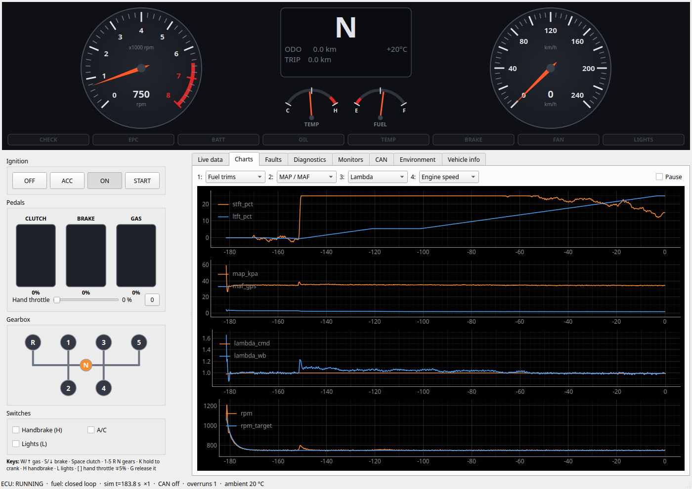

# ECU simulator

A simulated engine control unit for teaching and scan-tool testing. It models a ~2015 1.6 L DOHC
port-injected petrol engine in a 5-speed car, and answers generic OBD-II (SAE J1979) requests over a
real CAN bus, so any scan tool can read it like a car.



- **Drive it**: ignition key, pedals, hand throttle, H-pattern gearbox, instrument cluster with warning lamps.
- **Realistic engine and ECU**: cold start, open/closed loop, catalyst heating, fuel trims, knock control,
  purge, idle control, limp home.
- **Full generic OBD-II**: 42 live PIDs, freeze frame, pending/confirmed/permanent codes, Mode 06,
  readiness monitors, VIN; 11- or 29-bit CAN via SocketCAN, slcan, PCAN, Kvaser, candleLight.
- **About 50 injectable faults** (vacuum leaks, misfires, worn catalyst, sensor circuits, EVAP leaks, ...)
  that the simulated ECU has to detect by itself, with one-click classroom scenarios.

**User guide with teaching scenarios: [docs/USAGE.md](docs/USAGE.md)** · Design: [docs/DESIGN.md](docs/DESIGN.md)

## Setup

```bash
python3 -m venv --system-site-packages .venv
.venv/bin/pip install "python-can>=4.3" msgpack PySide6 pyqtgraph pytest matplotlib
```

## Standalone binary

One self-contained executable, no Python needed on the target machine:

```bash
./packaging/build_linux.sh        # -> dist/ecusim  (~80 MB)
```

```bash
dist/ecusim                                              # desktop app
dist/ecusim --interface socketcan --channel can0         # desktop app on a real CAN bus
dist/ecusim headless --interface socketcan --channel can0 --start
dist/ecusim tester --interface socketcan --channel can1
```

The Linux binary runs on distributions with glibc as new as the build machine's or newer. Build
Windows and macOS binaries on those systems with `packaging/build_windows.ps1` and
`packaging/build_macos.sh` (PyInstaller does not cross-compile). On Windows and macOS a CANable with
candleLight firmware is used through `--interface gs_usb --channel 0` (Windows needs the WinUSB driver,
e.g. installed with Zadig), or flash the slcan firmware and use `--interface slcan --channel COM3`.

## Arch Linux package

```bash
cd packaging/arch
./build.sh -si        # builds ecusim-0.1.0-1-any.pkg.tar.zst, installs dependencies and the package
```

The package uses the system Python, `pyside6`, `python-can` and friends from the official repositories,
installs the `ecusim` command, an application-menu entry with an icon, and the user guide in
`/usr/share/doc/ecusim`. `build.sh` packs the current source tree, records its checksum in the
PKGBUILD and runs `makepkg` (extra arguments go to makepkg, e.g. `--nocheck` to skip the test suite).

## Icons

The icon is defined once in `ecusim/ui/icon.py` (a full design, plus a simplified one for 16–48 px).
`python tools/make_icons.py` regenerates `packaging/linux/ecusim.svg` (Arch package),
`packaging/windows/ecusim.ico` (embedded in the Windows `.exe`) and `packaging/macos/ecusim.icns` (macOS app).

## Desktop app

```bash
.venv/bin/python -m ecusim.ui                                      # CAN over UDP multicast, no hardware
.venv/bin/python -m ecusim.ui --interface socketcan --channel vcan0
.venv/bin/python -m ecusim.ui --interface slcan --channel /dev/ttyACM0
```

Drive it from the keyboard: **K** (hold) crank · **Space** clutch (quick in, slow out) ·
**W/↑** gas · **S/↓** brake · **1–5 R N** gears (clutch pressed) · **H** handbrake · **L** lights.
Pedals can also be dragged with the mouse; right-click a pedal to hold it.

**Faults** tab: about 50 faults in 9 groups (air, fuel, ignition, mechanical, cooling, exhaust, EVAP,
electrical, sensors), each with severity, cylinder, sensor failure mode (open, short to ground or 5 V,
offset, gain, stuck, slow, noisy) and optional intermittency, plus one-click scenario presets. Faults
act on the engine or the sensor wiring only; the ECU's own monitors have to find them, and the
**Monitors** tab tells you what each monitor is still waiting for.

ECU memory (learned fuel trims, DTCs, freeze frame, readiness, counters, odometer, engine
temperatures) is saved on exit and restored on the next launch, with the engine cooled for the real
time that passed. It lives in `~/.local/share/ecusim` (Linux), `%APPDATA%\ecusim` (Windows) or
`~/Library/Application Support/ecusim` (macOS). Use `--no-state` to start fresh. The Diagnostics tab
has **Battery disconnect** (wipes keep-alive memory; permanent DTCs survive) and **Key off and soak**.

## Headless ECU on a CAN bus

No hardware (two processes on one machine, via UDP multicast):

```bash
.venv/bin/python -m ecusim --start
.venv/bin/python tools/obd_tester.py
.venv/bin/python tools/obd_tester.py --live 0C,05,0B,10,0E,06,03
.venv/bin/python tools/obd_tester.py --clear        # Mode 04
```

Linux virtual CAN (lets you use `candump vcan0` alongside):

```bash
sudo ip link add dev vcan0 type vcan && sudo ip link set vcan0 up
.venv/bin/python -m ecusim --interface socketcan --channel vcan0 --start
```

Real adapter, e.g. CANable with slcan firmware, wired to a female OBD-II connector
(pin 6 CAN-H, 14 CAN-L, 4/5 ground, 16 +12 V for the scan tool, 120 Ω termination):

```bash
.venv/bin/python -m ecusim --interface slcan --channel /dev/ttyACM0 --bitrate 500000 --start
```

Add `--state-dir DIR` to keep ECU memory between runs. Console commands: `on`, `off`, `start`, `pedal <0-100>`, `status`, `bus`, `speed <x>`, `quit`.

## Serial (slcan) adapters

Adapters that appear as a serial port (`/dev/ttyACM*`, `/dev/ttyUSB*`, `COMx`, `/dev/cu.usbmodem*`) and
speak the LAWICEL/slcan protocol work with `--interface slcan`; the CAN bitrate is sent to the adapter:

```bash
dist/ecusim --interface slcan --channel /dev/ttyACM0 --bitrate 500000
dist/ecusim headless --interface slcan --channel COM3 --start
dist/ecusim headless --interface slcan --channel /dev/ttyUSB0 --tty-baudrate 2000000 --start
```

`--tty-baudrate` (or *Serial baud rate* in the CAN tab) only matters for adapters behind a USB-serial
converter (ttyUSB / FTDI / CH340, e.g. LAWICEL CANUSB or cheap clones); check the adapter's documentation,
common values are 115200, 1000000, 2000000 and 3000000. USB-CDC devices (ttyACM, CANable with slcan
firmware) ignore it. Measured with an original CANable on slcan firmware (cantact-fw): fine on a quiet bus (0 lost in 14,657
requests, ~1 ms response), but under heavy background traffic the firmware silently drops about 0.3-0.5 % of
the frames it is asked to send (it never acknowledges transmissions, so the host cannot retry). Scan tools
retry on timeout, so this shows up as an occasional slow reading. The same board flashed with candleLight
firmware (SocketCAN on Linux, `gs_usb` elsewhere) lost nothing at ~85 % bus load.

On Linux you can alternatively turn an slcan device into a SocketCAN interface with
`sudo slcand -o -s6 -t hw /dev/ttyACM0 can2 && sudo ip link set can2 up` and use `--interface socketcan`.

## Bench test on real CAN hardware

With two adapters wired together (e.g. two CANables, candleLight firmware, both at 500 kbit/s):

```bash
ECUSIM_HW=can0,can1 .venv/bin/python -m pytest -q tests/test_hardware.py
```

The ECU runs on the first interface and the tester on the second (11- and 29-bit). If can-utils'
`isotpsend`/`isotprecv` are installed, the kernel's ISO-TP stack is used as an independent tester.

## Documentation screenshots

```bash
QT_QPA_PLATFORM=offscreen .venv/bin/python tools/make_doc_screenshots.py   # regenerates docs/images/*.png
```

## Headless scenarios and tests

```bash
python3 tools/run_scenario.py cold-start --ambient 15   # CSV + PNG in out/
.venv/bin/python -m pytest -q
```
