# ECU Simulator — User Guide

The ECU Simulator behaves like the engine control unit of a petrol car: a 1.6 litre, 4-cylinder,
16-valve engine with port fuel injection and a 5-speed manual gearbox, from around 2015. You drive the car on
screen, and any **generic OBD-II scan tool** plugged into a real CAN bus reads it exactly as it would read a car:
live data, trouble codes, freeze frames, readiness monitors, Mode 06 test results and the VIN.

You can also break the car on purpose. About 50 faults (vacuum leaks, misfires, worn catalysts, broken sensors,
EVAP leaks and more) act on the simulated engine and its wiring only. The simulated ECU has to *find* them itself,
using the same strategies a real one uses. That makes it a safe, repeatable training car for a classroom.

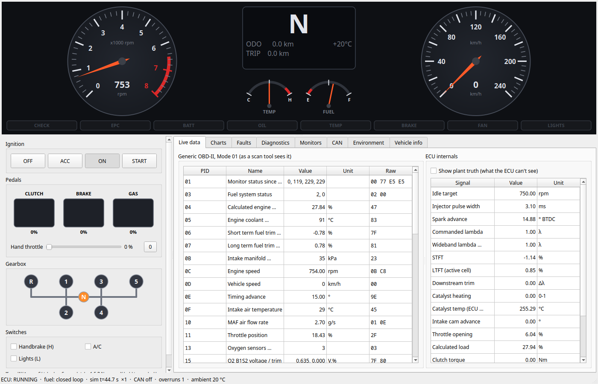

---

## Contents

1. [Quick start](#1-quick-start)
2. [The window at a glance](#2-the-window-at-a-glance)
3. [Driving the car](#3-driving-the-car)
4. [The tabs](#4-the-tabs)
5. [Connecting a scan tool](#5-connecting-a-scan-tool)
6. [Teaching scenarios](#6-teaching-scenarios)
   - [A. Cold start and warm-up: open and closed loop](#a-cold-start-and-warm-up-open-and-closed-loop)
   - [B. Reading fuel trims: the vacuum leak](#b-reading-fuel-trims-the-vacuum-leak)
   - [C. Fuel-trim fingerprints: which fault is it?](#c-fuel-trim-fingerprints-which-fault-is-it)
   - [D. Misfire diagnosis with Mode 06 and freeze frame](#d-misfire-diagnosis-with-mode-06-and-freeze-frame)
   - [E. Catalyst efficiency and the two oxygen sensors](#e-catalyst-efficiency-and-the-two-oxygen-sensors)
   - [F. Broken sensors, failsafes and limp home](#f-broken-sensors-failsafes-and-limp-home)
   - [G. Readiness monitors and the emissions inspection](#g-readiness-monitors-and-the-emissions-inspection)
   - [H. The mystery car (assessment)](#h-the-mystery-car-assessment)
7. [Tips for the classroom](#7-tips-for-the-classroom)
8. [Troubleshooting](#8-troubleshooting)
9. [Reference](#9-reference)

---

## 1. Quick start

**On Linux** the simulator is a single file, `ecusim`. Nothing needs installing.

```bash
./ecusim                                              # just the simulator, no CAN hardware
./ecusim --interface socketcan --channel can0         # on a real CAN bus (see section 5)
```

To drive it for the first time:

1. Click **ON** in the *Ignition* box. The dashboard lamps light for a bulb check and the fuel pump primes.
2. Press and **hold START** (or hold the **K** key) until the engine runs, about one second, then let go.
3. Watch the rev counter flare and settle to idle.

What the car has learned and stored (fuel trims, trouble codes, readiness, odometer and trip) is kept when you close the
program, the way a real car's ECU keeps it with the battery connected. It is stored in `~/.local/share/ecusim`
(Windows: `%APPDATA%\ecusim`). Start with `--no-state` for a clean car that forgets everything on exit.

| Command line option | What it does |
|---|---|
| `--interface`, `--channel` | CAN adapter to use (section 5). Without hardware the default needs no setup. |
| `--bitrate 500000` | CAN bitrate (500 kbit/s is standard for OBD-II). |
| `--29bit` | Use 29-bit CAN identifiers instead of 11-bit. |
| `--ambient 5` | Outside temperature in °C. |
| `--no-can` | Start without connecting to CAN. |
| `--no-state` | Do not load or save the ECU memory. |
| `--time-scale 5` | Run the simulation 5× faster than real time. |
| `./ecusim headless …` | Run the ECU without a window (on a CAN bus, with a text console). |
| `./ecusim tester …` | A simple built-in scan tool, for checking a bench set-up. |

---

## 2. The window at a glance

| Area | What it is |
|---|---|
| **Instrument cluster** (top) | Rev counter, speedometer, coolant and fuel gauges, gear, odometer and trip, outside temperature, and warning lamps. Click the centre display to reset the trip. |
| **Driver controls** (left) | Ignition key, clutch, brake and gas pedals, hand throttle, gear lever and switches. |
| **Tabs** (right) | Live data, Charts, Faults, Diagnostics, Monitors, CAN, Environment and Vehicle info. |
| **Status bar** (bottom) | ECU state (off, key on, cranking, running), fuel system status, simulated time, CAN connection. |

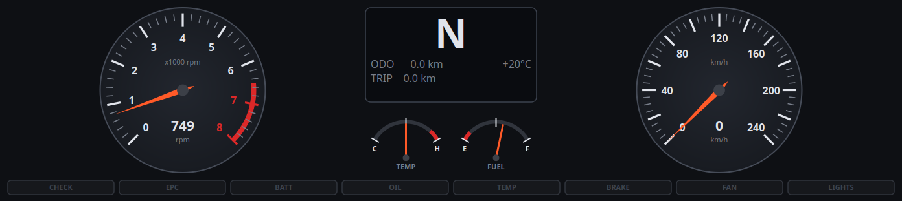

| Lamp | Meaning |
|---|---|
| **CHECK** (amber) | Malfunction indicator lamp (MIL). Steady: an emission fault is confirmed. **Flashing**: a misfire bad enough to damage the catalyst. All lamps light briefly at key-on (bulb check). |
| **EPC** (amber) | Throttle or pedal fault. The engine is in *limp home* or reduced-power mode. |
| **BATT** (red) | The alternator is not charging (normal with the key on and the engine stopped). |
| **OIL** (red) | No oil pressure (normal with the key on and the engine stopped). |
| **TEMP** (red) | Coolant above 115 °C. |
| **BRAKE** (red) | Handbrake on. |
| **FAN** (blue) | Radiator fan running. |
| **LIGHTS** (green) | Headlights on. |

The coolant gauge behaves like a real one: the needle stays in the middle across the whole normal range
(about 75–105 °C). Use **Live data** when you need the exact temperature.

---

## 3. Driving the car

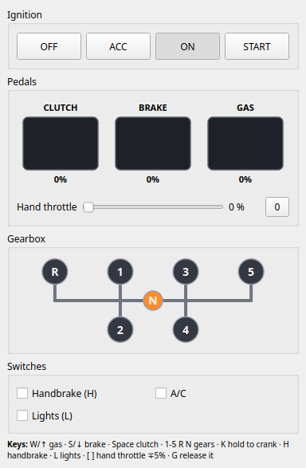

| Control | Mouse | Keyboard |
|---|---|---|
| Ignition | OFF, ACC, ON buttons; **START** is held down while cranking | hold **K** to crank |
| Gas | drag the green pedal down | hold **W** or **↑** |
| Brake | drag the red pedal | hold **S** or **↓** |
| Clutch | drag the blue pedal | hold **Space** (it goes in quickly and comes out slowly, so you can pull away) |
| **Hand throttle** | slider under the pedals: holds the gas at a set level | **[** and **]** move it in 5 % steps, **G** releases it |
| Gears | click a position on the gear lever | **1**–**5**, **R**, **N** |
| Handbrake, lights, A/C | tick boxes | **H**, **L** |

Right-click a pedal to make it stay where you leave it. The pedal also adds gas on top of the hand throttle;
when you release it, the gas returns to the hand-throttle level.

**Starting.** The starter only turns with the gearbox in neutral or the clutch pressed, as on most manual cars.
"PRESS CLUTCH TO START" appears in the cluster otherwise.

**Pulling away.** Press the clutch (hold Space), select 1st (press 1), add a little gas, then let the clutch
out (release Space). The clutch has a bite point, as in a real car, and you can stall: let it out too quickly
with no gas, or hold the brake, and the engine stops. Gear changes need the clutch pressed; otherwise the lever
is refused and the cluster says "PRESS CLUTCH TO SHIFT".

**Holding a steady speed.** Put the car in 4th or 5th and use the **hand throttle** instead of holding a key.
Several tests (catalyst, EVAP) need a steady cruise, and the hand throttle makes that easy. As a guide, about
35 % holds 100 km/h in 5th on a flat road.

**Speeding up time.** A real warm-up takes 12–15 minutes at idle. **Environment → Time acceleration** runs the
simulation up to 20× faster. A scan tool connected over CAN still sees correct, real-time responses.

---

## 4. The tabs

**Live data.** On the left are all 42 standard OBD-II values (Mode 01 PIDs) exactly as a scan tool decodes them,
with the raw bytes. On the right are ECU internals that generic OBD-II cannot show: injector pulse width, spark
advance, idle target, catalyst-heating state, cam timing and more.
Tick **Show plant truth (what the ECU can't see)** to add the *real* engine values in orange: true air flow,
true lambda, true coolant temperature and so on. Comparing what a sensor says with what is really happening is a
powerful way to teach.

**Charts.** Four live strip charts covering the last two minutes. Pick what each one shows: Engine speed, Vehicle
speed, Pedals, Temperatures, Catalyst, MAP / MAF, Lambda, Fuel trims, Spark, Injector PW, Downstream O2, Load
and Battery. **Pause** freezes the charts for discussion.

**Faults.** Every fault the car can have, grouped by system. Select one to see what it should cause, tick
**Fault active**, and set its strength, cylinder or (for sensors) the failure mode: open circuit, short to
ground, short to 5 V, offset, gain error, stuck, slow or noisy. **Intermittent** makes a fault come and go.
The **Scenario** list at the top sets up a whole lesson in one click. **Save current as preset…** keeps your own
scenarios. **Clear all faults** repairs the car.

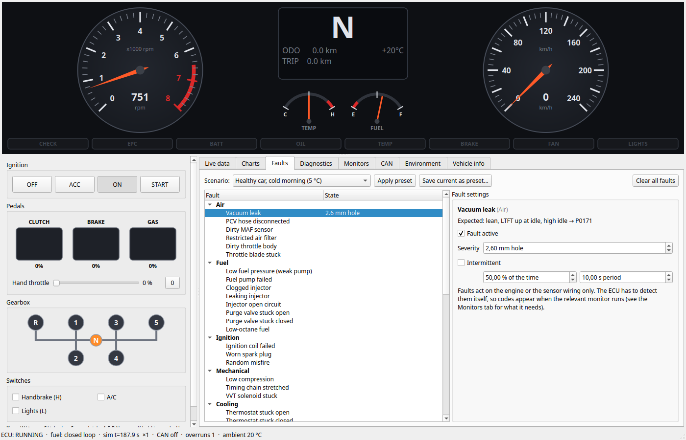

**Diagnostics.** What the ECU has stored. It shows the MIL state; the trouble codes as *pending* (Mode 07),
*confirmed* (Mode 03) and *permanent* (Mode 0A); the freeze frame (Mode 02); and the Mode 06 test results. The
counters are the ones the OBD standard defines: warm-ups, distance and time since codes were cleared, distance
with the MIL on, trips and ignition cycles. Its buttons:
- **Clear codes (same as Mode 04)**: what a scan tool's "clear codes" does.
- **Battery disconnect…**: the ECU forgets everything except permanent codes.
- **Key off and soak**: switches off and lets the engine cool for a chosen number of hours, instantly.

**Monitors.** The readiness monitors as an inspection station sees them, one row per monitor. Each shows whether
it is complete since codes were cleared (PID 01) and this drive cycle (PID 41). The last column explains
**what the monitor is still waiting for**, for example "needs a steady 40–110 km/h cruise". Each monitor can
follow the real logic (*auto*) or be forced *complete* or *incomplete*.

**CAN.** Choose and connect the CAN adapter, and watch the bus trace. Every frame is decoded, so students can
follow a request and its multi-frame answer.

**Environment.** Outside temperature, air pressure (altitude), road grade, fuel level and time acceleration.
**Cold soak (overnight at ambient)** and **Hot soak (stopped a few minutes ago)** reset the engine temperatures.
Both keep the odometer, the fuel and the learned trims.
**Reset trip** sets the trip to 0 (so does clicking the centre display of the cluster). **Reset odometer…** sets
the odometer and the trip to 0 after asking. Neither touches the ECU's own OBD counters (distance since codes
cleared, distance with the MIL on): those reset with *Diagnostics → Clear codes*, as in a real car.

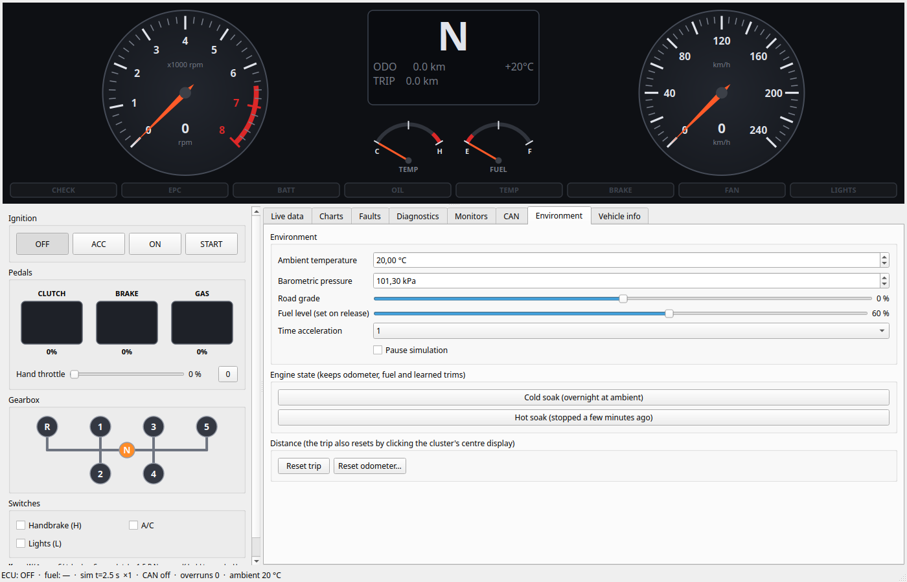

**Vehicle info.** The VIN, calibration ID, CVN and ECU name reported to scan tools. **Fix check digit** corrects
an invented VIN. *OBD standard* switches between EU (EOBD) and US (OBD-II) behaviour. In US mode, for example,
the EVAP test also looks for very small leaks (P0456).

---

## 5. Connecting a scan tool

### Without any hardware

The built-in tester needs nothing extra. Start the simulator normally and, in a second terminal:

```bash
./ecusim tester                                   # reads VIN, codes, readiness and live values
./ecusim tester --live 0C,05,0B,10,0E,06          # live RPM, coolant, MAP, MAF, timing, STFT
```

### With a real scan tool

You need a USB–CAN adapter for the PC and a female OBD-II socket to plug the scan tool into.

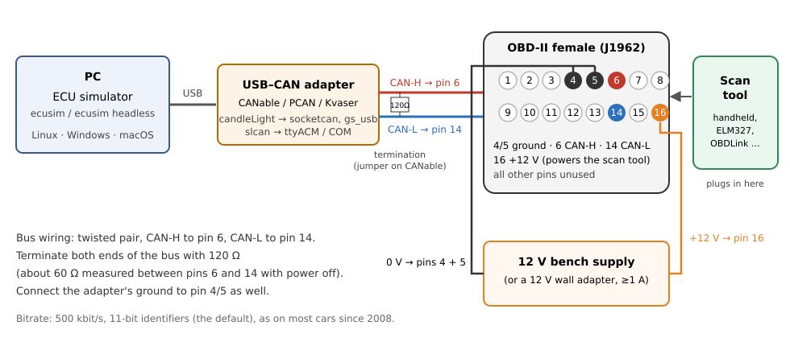

**Important:** most scan tools take their power from **pin 16 (+12 V)** of the socket. Without a 12 V supply
on pin 16 and ground on pins 4/5, the tool stays dark and "cannot find the vehicle".

| Adapter | How to start the simulator |
|---|---|
| CANable / candleLight, PCAN or Kvaser on **Linux** | `./ecusim --interface socketcan --channel can0` (first: `sudo ip link set can0 up type can bitrate 500000`) |
| CANable with **slcan** firmware, or another serial adapter | `./ecusim --interface slcan --channel /dev/ttyACM0` (Windows: `COM3`) |
| Serial adapter behind a USB–serial chip (ttyUSB) | add `--tty-baudrate 115200` (or whatever the adapter documentation says) |
| CANable / candleLight on **Windows or macOS** | `--interface gs_usb --channel 0` |
| PEAK PCAN on Windows | `--interface pcan --channel PCAN_USBBUS1` |

The same choices are on the **CAN** tab. Once connected, the trace shows every request and answer:

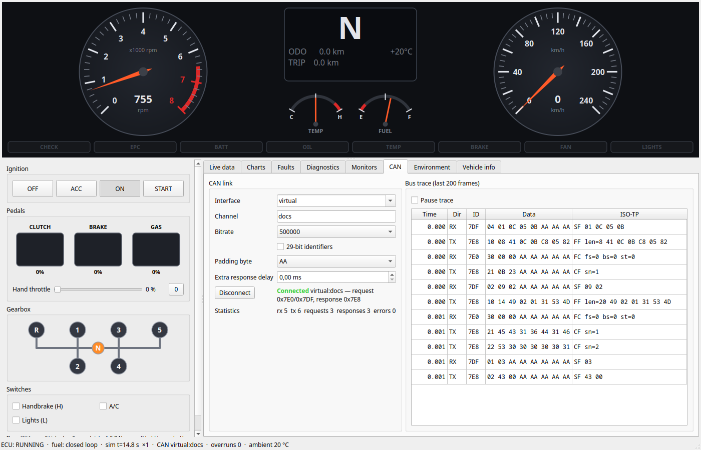

The scan tool must be set to (or will auto-detect) **ISO 15765-4 CAN, 11-bit, 500 kbit/s**. The ECU only answers
while the ignition is **ON** or the engine is running, as a real car does.

---

## 6. Teaching scenarios

Each scenario lists the set-up, the steps, what students should see and questions to ask. The answers are for
the teacher. The numbers quoted come from runs of the simulator itself.

Before each scenario: **Faults → Clear all faults**, and if old codes would confuse things,
**Diagnostics → Clear codes**.

---

### A. Cold start and warm-up: open and closed loop

**Goal:** understand why a cold engine runs rich, what "closed loop" means, and how the idle speed and the
oxygen sensor behave while the engine warms up.
**Time:** 15 minutes (5 at 4× time acceleration).

**Set-up:** Environment → Ambient temperature **10 °C**, then **Cold soak (overnight at ambient)**.
Charts: *Engine speed*, *Temperatures*, *Lambda*, *Fuel trims*.

**Steps:**
1. Key **ON**. Ask students to read coolant and intake air temperature on the scan tool. Both read 10 °C, since
   the engine has stood overnight.
2. Start the engine. Watch the first minute closely, then let it idle.
3. On the scan tool, follow **fuel system status** (PID 03), **commanded lambda** (PID 44) and **STFT**
   (PID 06).

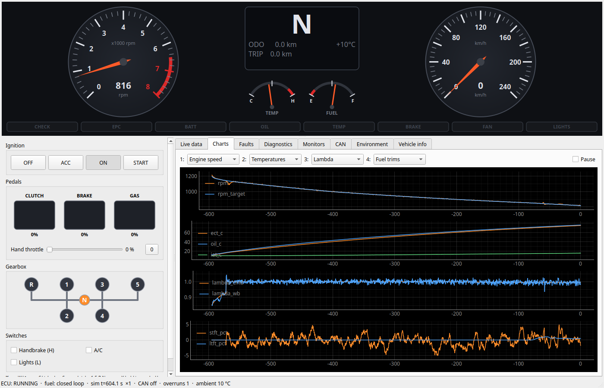

**What students should see:**
- A start flare to about 1,500 rpm, then a fast idle of about 1,150 rpm that falls slowly to 750 rpm as the
  coolant warms.
- Fuel system status **"open loop, insufficient temperature"**, with commanded lambda starting around 0.80 and
  rising towards 0.9: deliberately rich. STFT stays at 0 %, because the ECU is not using the oxygen sensor yet.
- After about 25–30 seconds the status changes to **"closed loop"**: the lambda reading starts to wobble around
  1.00 and STFT starts moving.
- In the first 30 seconds the spark timing (PID 0E) is around **0°**, very late. This is *catalyst heating*: the
  ECU sends heat into the exhaust to light off the catalytic converter quickly.

**Questions:**
1. Why does a cold engine need a richer mixture?
2. Why can't the ECU use closed loop straight after start-up?
3. Why is the ignition timing so late in the first half minute, and why doesn't the engine stall?
4. Why does the idle speed come down as the engine warms up?

<details><summary>Answers</summary>

1. Petrol evaporates poorly on cold metal. Part of the fuel stays on the port walls as a liquid film, so extra fuel is needed for the cylinder to receive enough vapour.
2. The oxygen sensor only works hot (above about 700 °C for the wideband sensor). Its heater needs around 15 seconds; until then the ECU uses its open-loop tables.
3. Late spark wastes energy into the exhaust, which heats the catalyst to its light-off temperature (about 280 °C) within about 30 seconds. The ECU opens the throttle a little more to keep the idle speed. Look at *Throttle opening* in Live data.
4. A cold engine has more friction (thick oil) and needs more air to keep running smoothly. The target idle is a table against coolant temperature.
</details>

---

### B. Reading fuel trims: the vacuum leak

**Goal:** understand short-term (STFT) and long-term (LTFT) fuel trim, and use them to recognise a vacuum leak.
**Time:** 15 minutes.

**Set-up:** Scenario **"Vacuum leak at idle"**, then **Apply preset** (warm engine, a 2.6 mm hole in the intake
after the air-flow meter). Charts: *Fuel trims*, *MAP / MAF*, *Lambda*, *Engine speed*.
A good variation is to start the engine healthy, show normal trims, and *then* tick the fault on in the Faults
tab, so students see the moment it happens.

**Steps:**
1. Start the engine and let it idle. On the scan tool, show STFT, LTFT, MAF, MAP and RPM.
2. Switch the vacuum leak on (if it isn't already) and watch the next three minutes.
3. Then raise the engine speed in neutral with the **hand throttle**: about 20 % (about 1,500 rpm), then about
   30 % (about 3,500 rpm). Note the trims at each speed. Return to idle.

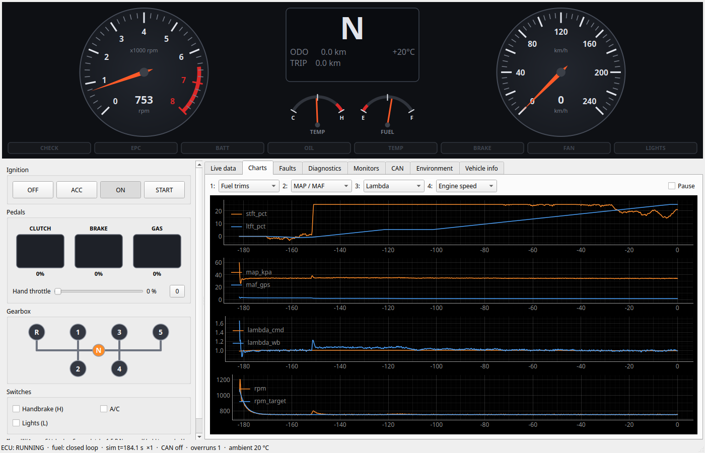

**What students should see:**
- The moment the leak opens, lambda jumps lean and **STFT shoots to its +25 % limit** within a couple of seconds.
- Over the next two minutes **LTFT climbs** (it learns slowly) while STFT relaxes. The ECU is moving the
  correction from "short-term" to "learned".
- **MAF reads less than normal**: 1.5–1.6 g/s instead of about 2.3 g/s at idle. The leaking air bypasses the
  air-flow meter, and the idle control closes the throttle to hold the speed.
- **MAP is unchanged** (about 34 kPa). The engine still gets the same air, just partly through the wrong path.
- After about three minutes the scan tool shows a **pending P0171** (system too lean, bank 1).
- With the hand throttle, the leak "disappears" as the engine draws more air:

| Engine speed (neutral) | STFT + LTFT (total correction) |
|---|---|
| Idle, 750 rpm | **+45 %** |
| Hand throttle 20 %, about 1,500 rpm | +19 % |
| Hand throttle 30 %, about 3,500 rpm | +6 % |


**Questions:**
1. What is the difference between STFT and LTFT, and why does a car need both?
2. A positive trim means the ECU is *adding* or *removing* fuel?
3. Why does the MAF reading *drop* when there is a vacuum leak?
4. Why is the leak so much smaller in percentage terms at 3,500 rpm?
5. What simple test would you do on a real car to confirm a vacuum leak?

<details><summary>Answers</summary>

1. STFT is the fast correction from the oxygen sensor. It reacts within a fraction of a second and is limited to ±25 %. LTFT learns the average of STFT over minutes and is kept in memory, so the next time the engine starts (even before the sensor is warm) the correction is already in place.
2. Adding. Positive = the ECU saw a lean mixture and is adding fuel.
3. Part of the air enters after the MAF. To hold idle speed, the ECU closes the throttle a little, so less air goes through the MAF. Total air into the engine is the same.
4. The leak lets in a roughly fixed amount of air (it depends on the manifold vacuum, not on engine speed). At idle the engine only uses about 2.5 g/s, so the leak is a large share; at 3,500 rpm the engine draws about 11 g/s.
5. Raise the revs and watch the trims come down (exactly what we did). Then, on a real car, spray a little propane or carburettor cleaner around the intake joints at idle: the trims drop sharply when the spray reaches the leak. Or use a smoke tester.
</details>

---

### C. Fuel-trim fingerprints: which fault is it?

**Goal:** use *where* the trims are wrong (idle or load, lean or rich) to tell faults apart.
**Time:** 30–45 minutes (groups).

**Set-up:** for each fault, start warm (Environment → **Hot soak**), switch on one fault from the Faults tab,
idle for 4 minutes, then drive at a steady 80 km/h in 4th for 4 minutes (hand throttle). Record STFT and LTFT at
idle and at 80 km/h.

Results from the simulator with the default fault strengths:

| Fault (Faults tab) | LTFT at idle | LTFT at 80 km/h | Code |
|---|---|---|---|
| *(healthy car)* | −1 % | +1 % | — |
| Air → **Vacuum leak** | **+25 %** (at the limit) | +7 % | P0171 |
| Fuel → **Low fuel pressure (weak pump)** | +25 % | **+25 %** | P0171 |
| Air → **Dirty MAF sensor** | +24 % | +25 %, and STFT another +10 % | P0171, P0101 |
| Fuel → **Leaking injector** | **−25 %** (rich) | −1 % | P0172 |
| Exhaust → **Exhaust leak before B1S1** | +11 % | +12 % | none at first; P2195 later |

**Questions:**
1. Two faults both give P0171. How do the trims tell a vacuum leak from a weak fuel pump?
2. Why does a leaking injector make the engine rich mainly at idle?
3. The dirty MAF gets *worse* at higher load. Why?
4. With an exhaust leak before the oxygen sensor, the trims say "lean". Is the engine really lean?
   *(Tick "Show plant truth" in Live data and compare **Wideband lambda (sensor)** with **Exhaust lambda (true)**.)*

<details><summary>Answers</summary>

1. A vacuum leak adds a fixed amount of air, so it matters most at idle and fades at load. A weak pump lowers fuel pressure, so every injection delivers less fuel: lean everywhere, often worst at high load.
2. The leak adds a roughly constant amount of fuel per second. At idle the engine uses very little fuel, so the leak is a large share; at 80 km/h it is small.
3. A contaminated hot-film element under-reads more at high air flow, so the ECU under-estimates the air (and the fuel needed) more and more as load increases.
4. No. Outside air is drawn into the exhaust at the leak (between pulses) and dilutes the gas the sensor sees, so it reads lean. The ECU adds fuel and the engine actually runs **rich**. The downstream oxygen sensor (after the catalyst) shows it: it stays high (rich). This is why the ECU eventually sets P2195 (upstream sensor stuck lean). Trims are only as good as the sensor feeding them.
</details>

---

### D. Misfire diagnosis with Mode 06 and freeze frame

**Goal:** understand how an ECU detects misfires, the two-trip logic for trouble codes, the freeze frame and the
per-cylinder misfire counters in Mode 06.
**Time:** 20 minutes.

**Set-up:** Scenario **"Misfire cylinder 3 under load"** (a worn spark plug in cylinder 3, which only misfires
when the engine works hard), then **Apply preset**.

**Steps:**
1. Start the engine. At idle everything looks normal; the plug only fails under load.
2. **Trip 1:** drive with plenty of gas: 2nd and 3rd gear, 60–80 % pedal, then 70 km/h for a minute or two.
   Check the scan tool: **pending P0303**, MIL still **off**.
3. Switch the key **OFF**, then **ON**, and start again. This begins a new trip.
4. **Trip 2:** drive the same way. Now P0303 is **confirmed**, the **MIL is on** and the code is also
   **permanent**.
5. Read the **freeze frame** (Mode 02) and **Mode 06** on the scan tool, or on the Diagnostics tab.

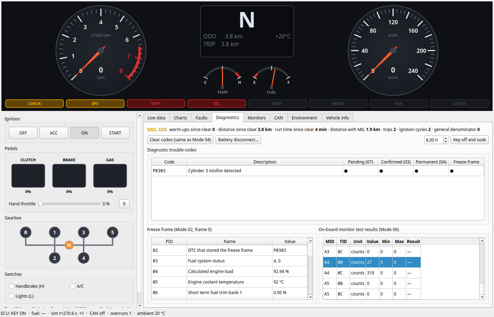

**What students should see:**
- Mode 06, MID **A4** (cylinder 3): misfire count this drive cycle (TID 0C) about 300; all other cylinders 0.
- The freeze frame captured the conditions of the misfire: high engine load (about 90 %), MAP near
  atmospheric, fuel system in open loop for power enrichment. That is the clue that the fault is load-related.
- Variation: Faults → Ignition → **Ignition coil failed**, cylinder 3. The MIL **flashes** at once (a misfire bad
  enough to damage the catalyst) and the ECU switches off cylinder 3's injector to protect the catalyst.

**Questions:**
1. How can the ECU know that a cylinder misfired, without any sensor inside the cylinder?
2. Why didn't the MIL light on the first trip?
3. What does the freeze frame tell you that the trouble code alone does not?
4. Why does the ECU cut the injector of a cylinder whose coil has failed?
5. After you replace the plug, how many trips until the MIL goes off by itself? And what about the
   *permanent* code?

<details><summary>Answers</summary>

1. From the crankshaft speed sensor. Each firing cylinder accelerates the crankshaft slightly; a cylinder that does not fire leaves a small slowdown in its part of the revolution. The ECU counts these per cylinder, over windows of 200 and 1,000 revolutions.
2. Two-trip logic: the first failure only stores a *pending* code. If the same fault appears on the next trip, it is confirmed and the MIL lights. This avoids lighting the lamp for a one-off event.
3. The operating conditions at the moment of the fault: load, speed, temperature, fuel trims. Here: high load, so the problem appears only when the cylinder pressure is high, which points to the ignition (plug, coil, lead).
4. Unburned fuel from that cylinder would burn inside the catalytic converter and overheat it.
5. The MIL goes off after **three** consecutive good trips; the confirmed code stays in memory as history for 40 warm-up cycles. The **permanent** code is erased when the monitor has run and passed; scan-tool "clear codes" (Mode 04) does *not* erase it.
</details>

---

### E. Catalyst efficiency and the two oxygen sensors

**Goal:** understand oxygen storage in the catalyst and how the ECU uses the second oxygen sensor to judge it.
**Time:** 20 minutes.

**Set-up:** first a healthy car (Hot soak, no faults). Charts: *Lambda*, *Downstream O2*, *Vehicle speed*,
*Fuel trims*. Drive to a steady **70 km/h** in 4th and hold it with the hand throttle for a minute. Then
**Pause** the charts. Repeat with the scenario **"Tired catalyst"**.

**Healthy catalyst:**
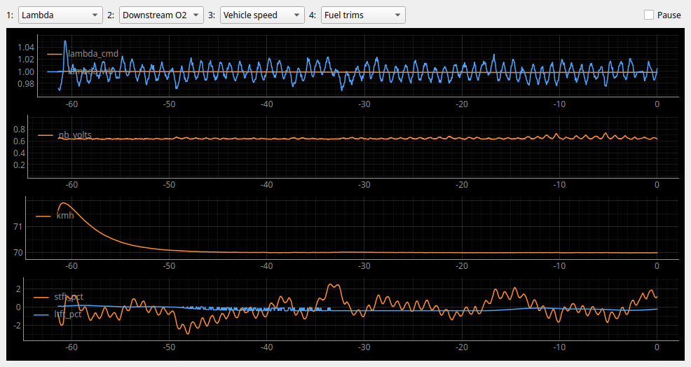

**Worn catalyst:**
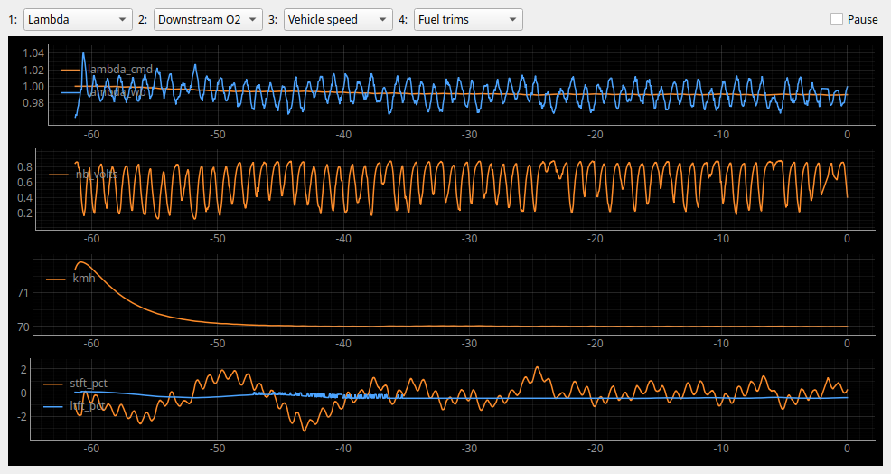

**What students should see:**
- Upstream (wideband lambda): in both cases a steady wobble of about ±2 % around lambda 1.00, about once a
  second. The ECU does this on purpose.
- Downstream (narrowband, volts): with the healthy catalyst it stays almost **flat at about 0.65 V**; with the
  worn one it swings **0.1–0.85 V**, following the upstream signal.
- With the worn catalyst, after 40 seconds of steady cruising the ECU sets **pending P0420**. Mode 06 MID 21
  shows the catalyst index (0 = perfect, the limit is 500).

**Questions:**
1. Why does the ECU make the mixture wobble on purpose?
2. Why is the downstream signal flat when the catalyst is good?
3. Why does the test need a steady cruise, and not idle?
4. A customer's car has P0420 *and* P0171. What should you fix first, and why?

<details><summary>Answers</summary>

1. A three-way catalyst needs an exhaust that alternates slightly between rich and lean. It stores oxygen during the lean moments and uses it during the rich ones. The small, regular wobble keeps it working and also gives the ECU a known "test signal".
2. A healthy catalyst stores and releases oxygen, smoothing out the wobble, so the gas after it is steady.
3. The monitor needs a stable, warm catalyst and enough exhaust flow for the wobble to be meaningful. At idle the flow is so small that even a worn catalyst can hide the wobble.
4. The P0171 (lean). A wrong mixture upsets the catalyst and its test. Fix the fuel fault, clear the codes, then re-check the catalyst. In the simulator, as in many real ECUs, the catalyst monitor will not even run while the fuel trims are at their limit or the engine misfires.
</details>

---

### F. Broken sensors, failsafes and limp home

**Goal:** see what the ECU does when a sensor fails, how the fault shows on a scan tool, and why the car can
still run.
**Time:** 20 minutes.

**Part 1: scenario "Dead coolant temperature sensor"** (the sensor wire is open).

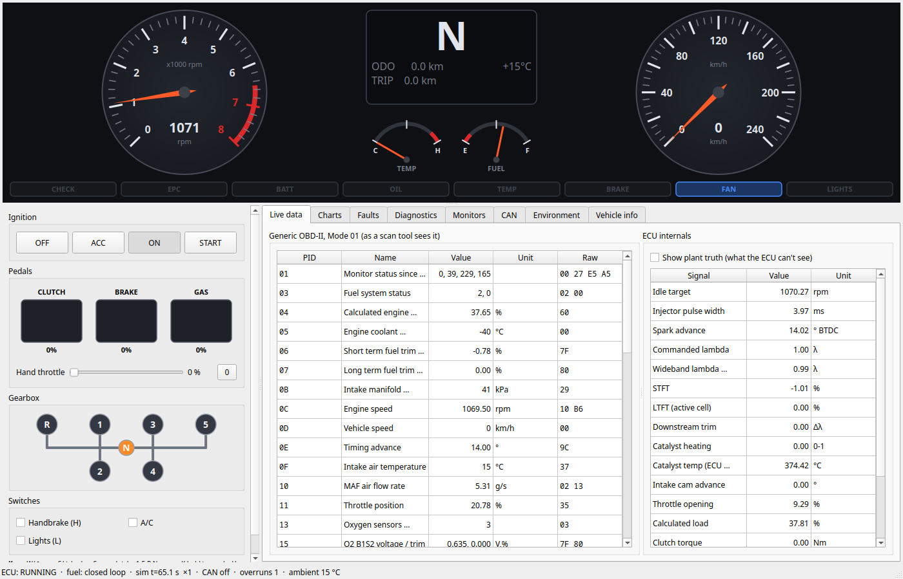

- The scan tool shows coolant temperature **−40 °C**, the classic sign of an open circuit (the input is pulled
  up to 5 V, which the sensor curve reads as the coldest possible value).
- The engine still runs normally. The ECU noticed the impossible voltage, stored **P0118**, and now uses a
  *model* of the coolant temperature built from the fuel it has burned.
- The **radiator fan runs all the time** (FAN lamp), since the ECU can no longer tell if the engine is hot.
- Try **short to ground** instead: the reading jumps to a very high temperature and the code is **P0117**.

**Part 2: scenario "Throttle sensors disagree (limp home)".**

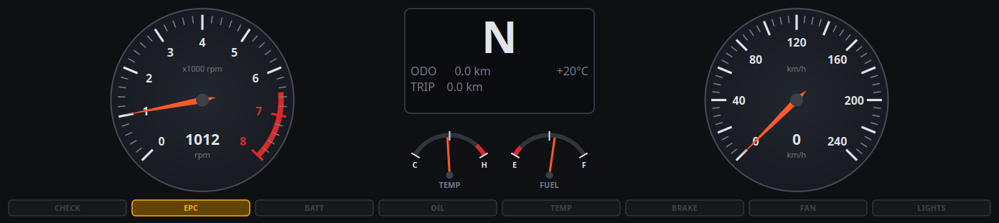

- The electronic throttle has two position sensors that must always agree. Here one is wrong by 15 %. Within a
  fraction of a second the ECU sets **P2135**, switches off the throttle motor, and the **EPC** lamp lights.
- The throttle springs to a small fixed opening. The engine runs at about 1,000 rpm and the gas pedal no
  longer does anything. In gear the car can only creep along on that engine speed: enough to get off the road
  slowly.
- Compare **Faults → Sensors → Pedal position sensor D**: the car goes into *reduced power* instead (the pedal
  works, but only up to about 40 %).

**Questions:**
1. How can the ECU tell an open circuit from a genuinely cold engine?
2. Why does a broken throttle sensor cause limp home, when a broken coolant sensor does not?
3. Why do throttles and pedals have *two* sensors each?

<details><summary>Answers</summary>

1. By the voltage. In normal use the coolant sensor voltage stays between roughly 0.5 and 4.8 V. An open circuit pulls it to 5 V (outside the possible range), a short to ground pulls it to 0 V.
2. If the ECU cannot be sure where the throttle is, it cannot safely control engine power; the car could accelerate unexpectedly. With a failed coolant sensor, a reasonable estimate is enough to keep running.
3. Safety: two independent sensors with different characteristics can check each other. If they disagree, the ECU knows *something* is wrong even if it cannot tell which one.
</details>

---

### G. Readiness monitors and the emissions inspection

**Goal:** understand readiness monitors, why clearing codes before an inspection does not help, and what a
"drive cycle" is.
**Time:** 25 minutes (or 10 with time acceleration).

**Set-up:** scenario **"Freshly cleared codes (readiness incomplete)"**. Open the **Monitors** tab and the scan
tool's readiness (I/M) screen side by side.

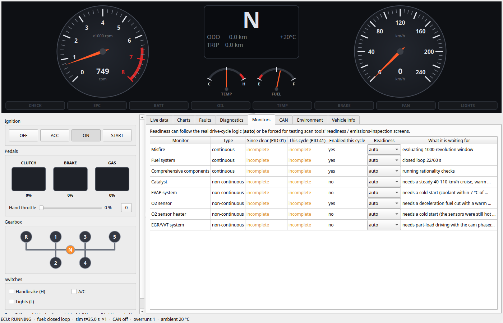

**Steps:**
1. After clearing, every monitor reads *incomplete*. This is what an inspection station sees if someone cleared
   the codes just before the test.
2. Read the right-hand column: each monitor explains what it still needs.
3. Do a full drive cycle:
   - **Environment → Cold soak**, then key on and start. The *O2 sensor heater* and *EVAP* tests need a cold
     start.
   - Idle about a minute.
   - Drive to a steady 60 km/h for about 7 minutes (hand throttle). The *catalyst* and, after 5 minutes of
     running, *EVAP* complete.
   - Lift off the gas in gear for a few seconds (a deceleration fuel cut). The *O2 sensor* test needs this.
   - Stop and idle a minute. *EGR/VVT* completes here: it compares the cam position during the cruise with its
     rest position at a warm idle.
4. Watch the monitors turn *complete* one by one, on the Monitors tab and on the scan tool.
5. For a quick demonstration of an inspection screen, set a monitor to **complete** or **incomplete** in the
   *Readiness* column.

**Questions:**
1. Why does clearing codes not get a car through an inspection?
2. Why do the EVAP and O2-heater tests need a cold start?
3. What is the difference between PID 01 (since codes cleared) and PID 41 (this drive cycle)?

<details><summary>Answers</summary>

1. Clearing codes also resets all monitors to *incomplete*. The inspection fails (or refuses to test) until enough monitors have run again, and if the fault is still there it comes straight back.
2. The EVAP test needs the fuel tank at a stable, known temperature, close to the air temperature. The heater test measures how long the sensors take to warm up from cold.
3. PID 01 shows which monitors have completed at least once since the codes were last cleared (what inspections use). PID 41 shows only the current trip.
</details>

---

### H. The mystery car (assessment)

**Goal:** a complete diagnosis using only a scan tool, as in a workshop.

**Set-up (teacher, before the students arrive):**
1. Choose a fault on the Faults tab, or a scenario. Good candidates: worn plug in one cylinder, vacuum leak,
   leaking injector, lazy upstream O2 sensor, stuck-open thermostat, fuel cap loose, low fuel pressure.
2. For an advanced class, tick **Intermittent** so the fault only appears part of the time. Or combine two
   faults.
3. Drive one or two trips so that codes and a freeze frame are stored, then key **OFF**.
4. Hide the simulator screen (a second monitor turned away, or a second PC running `./ecusim headless` on the
   same CAN bus). Students only get the scan tool.

**Student task:** read codes, freeze frame, readiness, live data and Mode 06; decide on the cause; write down
the evidence; say which repair they would do and how they would prove it is fixed.

**Checking the repair:** the student tells you the repair; you clear that fault on the Faults tab. Students then
show that the trims are normal, the monitor passes and, after the right number of trips, the MIL goes off.

---

## 7. Tips for the classroom

- **Repair the car between lessons:** *Faults → Clear all faults*, then *Diagnostics → Clear codes*. For a
  completely fresh car, use *Diagnostics → Battery disconnect…* (permanent codes still survive, as in a real
  car), or start the program with `--no-state`.
- **Save your own lessons** with *Save current as preset…*. They appear in the Scenario list next time.
- **Speed things up** with *Environment → Time acceleration* during warm-ups and long cruises. Use 1× while
  students are driving.
- **Show cause and effect** with *Live data → Show plant truth*. It shows what the engine is really doing
  next to what the sensors report.
- **Pause the charts** before asking a question about them.
- A projector works well with the window full-screen; the cluster, charts and lamps are readable at a distance.
- On a real scan tool, "no communication" almost always means the key is not ON, or pin 16 has no 12 V
  (section 8).

---

## 8. Troubleshooting

| Problem | What to check |
|---|---|
| The engine will not crank | Gearbox in neutral, or the clutch pressed (the cluster says "PRESS CLUTCH TO START"). Is a *Weak battery* or *Crankshaft position sensor* fault active? |
| The engine cranks but will not start | Faults tab: *Fuel pump failed*, *Crankshaft position sensor*, or an empty tank (Environment → Fuel level). |
| The scan tool says "no communication" | Ignition ON? CAN tab shows *Connected*? 12 V on pin 16 and ground on 4/5? Bus terminated (about 60 Ω between pins 6 and 14 with power off)? Tool set to CAN 11-bit 500 kbit/s? |
| CAN tab: "cannot open CAN interface" | Linux: is the interface up (`ip link show can0`)? For `/dev/ttyACM0`, your user must be in the `dialout` group (`uucp` on Arch Linux). Windows: is the adapter's driver installed? |
| Occasional slow or missing answers with an slcan adapter on a busy bus | slcan firmware can drop frames under heavy bus traffic (the scan tool just retries). candleLight firmware on the same CANable does not. |
| The window does not open (Linux) | Run it from a terminal to see the message. If `/tmp` does not allow running programs, start it with `TMPDIR=$HOME/.cache ./ecusim`. |
| A monitor never completes | Read its hint on the Monitors tab. EVAP and the O2 heater need a cold start (Environment → Cold soak). |

---

## 9. Reference

**OBD-II services the simulator answers:**

| Mode | What it is |
|---|---|
| 01 | Live data: 42 PIDs, including fuel trims, both O2 sensors, catalyst temperature, readiness |
| 02 | Freeze frame |
| 03 / 07 / 0A | Confirmed / pending / permanent trouble codes |
| 04 | Clear codes (refused while the engine is running, as many ECUs do) |
| 06 | On-board monitor test results: misfire counts per cylinder, O2 sensor response, catalyst, EVAP, VVT, heaters |
| 09 | VIN, calibration ID, CVN, ECU name, in-use monitor performance counters |

**Trouble codes the ECU can set:** around 90, covering misfire (P0300–P0304), fuel system (P0171/P0172),
catalyst (P0420), oxygen sensors and heaters (P0130–P0141, P2195/P2196, P0030/P0036), EVAP (P0441–P0456,
P0496), sensor circuits (MAF, MAP, coolant, intake air, throttle, pedal, knock, crank, cam, tank pressure, fuel
level, vehicle speed), injector and coil circuits, VVT and timing chain (P0011, P0012, P0016), thermostat
(P0128), idle speed (P0506/P0507) and system voltage (P0562/P0563). The Diagnostics tab shows a description for
each code it stores.

**Engine data:** 1,598 cc, 4 cylinders, 16 valves, intake cam phasing, 92 kW at 6,000 rpm, 158 Nm at
4,000–4,500 rpm, idle 750 rpm warm, rev limit 6,700 rpm. 5-speed manual gearbox, 1,250 kg; 100 km/h in 5th is
about 2,700 rpm.

The technical design (how the engine, sensors and ECU are modelled) is described in [DESIGN.md](DESIGN.md).
